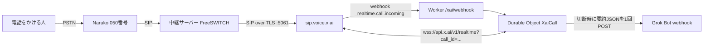

# naruko-grok-voice

Naruko の 050 番号にかかってきた電話（と、こちらからかける電話）を xAI **Grok Voice** につなぎ、通話が終わったら要約 JSON を 1 回だけ webhook に送る Cloudflare Worker です。
A Cloudflare Worker that bridges Naruko 050 phone calls to xAI Grok Voice over SIP and posts one call summary on hangup.


## 1. 仕組み / Architecture



- Grok Voice は**音声のまま直接会話**します。別の文章用 LLM は使いません。
- 声は `Ara`（`XAI_VOICE` で変更可）。課金は xAI API キーの従量です。
- 発信は SIP ヘッダー `X-Naruko-Direction=outbound` と `X-Naruko-Callee` で判別し、発信時は「AI であること」を名乗ってから用件を話す指示に切り替えます。

## 2. 各部品の役割 / Components

| 部品 | 役割 |
|---|---|
| Naruko | 050 番号と SIP トランク。着信を中継サーバーへ渡し、発信も受け付ける |
| FreeSWITCH | Naruko と xAI の間の SIP 中継。TLS で `sip.voice.x.ai` へ bridge（雛形: `docs/freeswitch/`） |
| xAI Grok Voice | 電話番号（xAI 側の phone）で SIP を受け、`realtime.call.incoming` webhook を Worker に送る |
| `src/xai-webhook.ts` | `/xai/webhook`。Standard Webhooks 署名（`whsec_`）を検証し、call_id ごとの DO を起動 |
| `src/xai-call.ts` | DO `XaiCall`。realtime WebSocket を通話終了まで維持、`session.update`、最初の挨拶、割り込み（barge-in）処理、文字起こし |
| `src/call-sideband.ts` / `transcript.ts` / `shared.ts` | 要約の組み立てと webhook 送信（1 通話 1 回）、番号の正規化、発着信の判定 |
| `src/index.ts` | ルーティング。`/` `/openai/webhook` は旧 OpenAI Realtime 経路（残置） |

## 3. 設定手順 / Setup

Node.js 22 推奨。

```bash
npm install
npx tsc --noEmit && npm test

# Grok Voice 経路で必要
npx wrangler secret put XAI_API_KEY
npx wrangler secret put XAI_WEBHOOK_SECRET   # xAI の webhook 署名シークレット (whsec_...)
npx wrangler secret put GROK_WEBHOOK_URL     # 要約の送り先
npx wrangler secret put GROK_WEBHOOK_AUTH    # 送り先の認証ヘッダー値
# 任意
npx wrangler secret put XAI_INSTRUCTIONS     # 着信時の指示を上書き
npx wrangler secret put XAI_VOICE            # 既定 Ara
npx wrangler secret put XAI_OUTBOUND_PURPOSE # 発信時の用件
# 旧 OpenAI 経路を使う場合のみ: OPENAI_API_KEY, OPENAI_WEBHOOK_SECRET, NARUKO_WEBHOOK_URL
# vars: TRANSCRIPTS_BUCKET_NAME, TRANSCRIPT_VIEWER_BASE_URL（Access で保護してから）, R2 binding TRANSCRIPTS（任意）

npx wrangler deploy
```

1. xAI コンソールで電話番号（phone）を用意し、webhook URL を `https://<worker>.<your-subdomain>.workers.dev/xai/webhook` に設定、署名シークレットを `XAI_WEBHOOK_SECRET` に入れる。
2. FreeSWITCH に `docs/freeswitch/naruko-gateway.xml`（Naruko トランク）と `docs/freeswitch/00_naruko_xai.xml`（xAI への bridge）を置き、`<...>` を自分の値に置き換えて `reloadxml`。
3. 050 番号に電話して、挨拶が流れ、切断後に要約が届くことを確認。

キー・番号・サーバーアドレスはリポジトリに入れず、すべて secret / ローカル設定で管理してください。

## 4. 失敗したときの見方 / Troubleshooting

- **発信で `603 Decline` / `404`**: ほぼキャリア側。Naruko トランクの発信許可（発信設定・発信先の制限）を確認する。FreeSWITCH の設定を変えても直らない。
- **着信が xAI に届かない**: `fs_cli` で `sofia global siptrace on` → INVITE/応答を見る。`NARUKO UNMATCHED` ログが出たら dialplan の番号正規表現か ACL が合っていない。
- **FreeSWITCH のログ時刻は UTC**。日本時間と 9 時間ずれるので、通話時刻と照合するときに注意。
- **webhook 署名検証の失敗（401）**: `XAI_WEBHOOK_SECRET` が xAI 側の現在値と一致しているか（再発行すると古い値は無効）。`webhook-id` / `webhook-timestamp` / `webhook-signature` ヘッダーが届いているか、本文を加工していないか。`npx wrangler tail` で確認。
- **要約が届かない**: `session.created/updated` を受け取れなかった通話（偽の call_id など）は要約を送らない仕様。`GROK_WEBHOOK_URL` / `GROK_WEBHOOK_AUTH` を確認。
- **長い通話**: DO の外向き WebSocket は約 15 分の keep-alive 制限があり、アラームで 8 分ごとに起こしている。

## License

MIT
