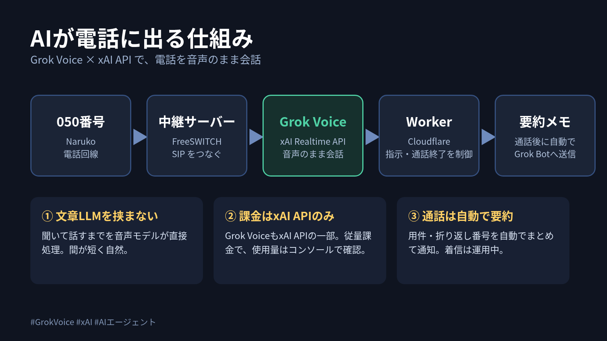
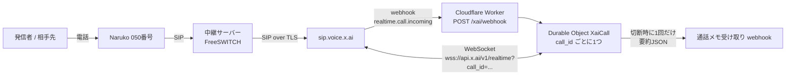

# naruko-grok-voice

**English summary:** A Cloudflare Worker that answers (and places) Japanese phone calls with xAI Grok Voice. Calls arrive from a Naruko 050 number, are relayed by FreeSWITCH to `sip.voice.x.ai` over TLS, xAI sends a `realtime.call.incoming` webhook to this Worker, and a Durable Object holds the xAI Realtime WebSocket for the whole call. Grok Voice speaks directly in audio (voice: Ara by default). On hangup the Worker builds a summary JSON and POSTs it once to a webhook of your choice.

電話（Narukoの050番号）に xAI の Grok Voice が音声のまま応対し、切断時に通話メモ（要約JSON）を指定の webhook へ1回だけ送る Cloudflare Worker です。

---

## 1. 仕組み





一言でいうと：**電話の音声は xAI 側で Grok Voice が直接しゃべり、Worker は「指示を渡す・会話を記録する・最後にメモを送る」だけを担当します。** 会話のために別の文章用LLMを挟みません。

## 2. 各部品の役割

| 部品 | 役割 | コード |
|---|---|---|
| Naruko | 050番号の電話回線。着信を SIP で中継サーバーへ渡す | （外部サービス） |
| FreeSWITCH | Naruko と xAI の間の中継。`sip.voice.x.ai` へ TLS で転送し、発信時は SIP ヘッダーを付ける | `docs/freeswitch/` に雛形 |
| xAI Grok Voice | 音声で会話する本体。着信時に Worker へ webhook を送る | （外部サービス） |
| Worker `/xai/webhook` | 署名検証（Standard Webhooks / `whsec_`、時刻ずれ許容 300 秒）→ 着信・発信の判定 → 指示文を組み立てて Durable Object を起動 → すぐ `200` を返す | `src/xai-webhook.ts` |
| Durable Object `XaiCall` | `call_id` ごとに1つ。xAI Realtime WebSocket を張り、`session.update`（指示・声・VAD・日本語の文字起こしヒント）と最初の挨拶を送る。文字起こしを保存し、切断時にメモを送る | `src/xai-call.ts` |
| 要約・メモ送信 | 切断時に全文の文字起こしから要約を作り、通話メモ webhook へ POST。`call_id` ごとに1回だけ（`summaryPosted`） | `src/call-sideband.ts`（共通処理を継承） |
| 指示文・ヘッダー解析 | 日本語ルール、電話応対マナー、`X-Naruko-*` ヘッダーの読み取り | `src/shared.ts` |

通話中の主な動き（コードで確認済み）:
- 声は `XAI_VOICE`（未設定なら `Ara`）。`turn_detection: server_vad`、文字起こしは `language_hint: "ja"`。
- 最初の一言はコード内の固定文。着信は「（COMPANY_NAME）のAIアシスタントです」、発信は「お世話になっております。（COMPANY_NAME）のAIアシスタントです。」＋用件。**どちらも冒頭でAIだと名乗ります。**
- AIが締めの挨拶のあと `end_call` ツールを呼ぶと、自動応答を止め、約13.5秒待ってから xAI の hangup API で切断します（相手が先に切るのを待つため）。
- 被せ（割り込み、barge-in）は xAI 側に任せ、Worker は `xai.barge_in` ログを出すだけです（応答の中断などは Worker からはしません）。
- 応答の速さを `xai.latency`（相手が話し終えてから音声が返るまでの ms）としてログに出します。
- Durable Object は 8 分ごとのアラームで生存を保ちます。

> 注: 以前の OpenAI Realtime 経路（`/` と `/openai/webhook`、`CallSideband`）は **legacy** として残っています。Grok Voice の経路は `/xai/webhook` です。

### 要約に使うモデル（重要）
会話そのものは **Grok Voice だけ**です。ただし切断時の通話要約は、`XaiCall` が旧 OpenAI 経路の要約コード（`CallSideband` を継承）を再利用しており、**OpenAI `gpt-4.1-mini`（Chat Completions）**で作っています。そのため `OPENAI_API_KEY` が必要で、xAI に加えて OpenAI にも少額の従量課金が発生します。xAI だけで完結させる差し替えは TODO です。

## 3. 設定手順

### 3-1. 準備
- Node.js 22（Wrangler でのビルド・デプロイ用）
- Cloudflare アカウント（Workers + Durable Objects）
- xAI API キーと、xAI 側の電話（SIP）設定
- Naruko の 050 番号と、FreeSWITCH を動かすサーバー

### 3-2. Worker をデプロイ

```bash
npm install
npm run check      # 型チェック + テスト + dry-run

npx wrangler secret put XAI_API_KEY          # xAI API キー
npx wrangler secret put XAI_WEBHOOK_SECRET   # xAI webhook の署名シークレット（whsec_...）
npx wrangler secret put GROK_WEBHOOK_URL     # 通話メモを受け取る webhook の URL
npx wrangler secret put GROK_WEBHOOK_AUTH    # その Bearer トークン本体（"Bearer " は付けない）
npx wrangler secret put OPENAI_API_KEY       # 切断時の要約に使用（下の注を参照）

# 任意
npx wrangler secret put COMPANY_NAME         # 会社名（未設定なら「当社」）
npx wrangler secret put OWNER_NAME           # 取り次ぎ先の担当者名（未設定なら「担当者」）
npx wrangler secret put ASSISTANT_NAME       # アシスタント名（未設定なら「AIアシスタント」）
npx wrangler secret put TASK_NAME            # 着信タスクの用件名（未設定なら「ご用件」）
npx wrangler secret put XAI_VOICE            # 未設定なら Ara
npx wrangler secret put XAI_INSTRUCTIONS     # 着信時の基本指示（未設定なら内蔵の受付文）
npx wrangler secret put XAI_OUTBOUND_PURPOSE # 発信時の用件（未設定なら内蔵の既定文）

npm run deploy
```

- 秘密値はすべて `wrangler secret put` で入れ、リポジトリには入れません。ローカル開発では `.dev.vars`（`.gitignore` 済み）を使います。
- Durable Object（`CALL_SIDEBAND`、`XAI_CALL`）の設定は `wrangler.jsonc` にあります。

### 3-3. xAI 側の webhook
xAI の電話設定で、着信時の webhook 送り先を `https://<your-worker>.workers.dev/xai/webhook` にし、発行された署名シークレットを `XAI_WEBHOOK_SECRET` に入れます。受け取るイベントは `realtime.call.incoming` です。
（xAI コンソールでの具体的な操作手順は未確認。TODO）

### 3-4. FreeSWITCH から sip.voice.x.ai へ TLS 転送
FreeSWITCH で Naruko からの通話を `sip.voice.x.ai:5061;transport=tls` へブリッジします。雛形:
- `docs/freeswitch/naruko-gateway.xml` … Naruko トランク（gateway）
- `docs/freeswitch/00_naruko_xai.xml` … 着信 dialplan と発信の例

`<...>` を自分の値に置き換え、ACL `naruko` に Naruko の SIP アドレスを許可してから `reloadxml` します。

### 3-5. 着信と発信の切り替え（SIPヘッダー）
Worker は xAI から届く `sip_headers` を見て判定します（`src/shared.ts`）。

| ヘッダー | 意味 |
|---|---|
| `X-Naruko-Direction` | 値が `outbound` のときだけ発信扱い。それ以外・なしは着信 |
| `X-Naruko-Callee` | 発信時の相手番号（通話メモ用） |
| `X-Naruko-Caller` / `From` | 着信時の発信者番号（なければ「非通知」） |

FreeSWITCH の発信ブリッジで、たとえば `sip_h_X-Naruko-Direction=outbound` と `sip_h_X-Naruko-Callee=<番号>` を付けると発信扱いになります。発信のときは指示が「こちらから電話をかけたAIアシスタント」に切り替わり、受付の決まり文句は使いません。`+81` の番号は通話メモ用に `0` 始まりへ直します。

## 4. 失敗したときの見方

ログは Cloudflare Workers の Observability（`wrangler.jsonc` で有効）で見られます。

| 症状 | 見る場所・ログ | 考えられる原因 |
|---|---|---|
| Worker が 500 を返す | `xai.configuration_missing` | `XAI_API_KEY` / `XAI_WEBHOOK_SECRET` の未設定 |
| Worker が 400 を返す | `xai.webhook.invalid_signature` | シークレット違い、または時刻ずれ 300 秒超 |
| webhook は来るが何も起きない | `xai.webhook.ignored` | `realtime.call.incoming` 以外のイベント |
| webhook 自体が来ない | Worker のログに何も出ない | xAI 側の送り先 URL 設定、または FreeSWITCH→xAI の手前で止まっている（Worker 側では検知できない） |
| 通話がつながっても声が出ない | `xai.run.failed`（`xAI WebSocket handshake failed (…)`）、`xai.do.start_failed` | API キー誤り、`call_id` の期限切れなど |
| 途中で切れる・メモが来ない | `xai.closed`（code / reason）、`xai.closed_without_session`、`xai.server_error` | WebSocket 切断。session が始まらなかった通話ではメモを送りません |
| メモの送信に失敗 | `grok.summary.config_missing`、`grok.summary.failed`、`xai.summary.retry` | 送り先の設定漏れや一時エラー。2 分ごとに最大 15 回まで再送します |
| 発信で SIP `603 Decline` / `404` | Worker 側ではなく FreeSWITCH のログ | キャリア側（Naruko トランクの発信許可）。FreeSWITCH の設定変更では直らない |
| 着信が xAI に届かない | `fs_cli` で `sofia global siptrace on`、ログの `NARUKO UNMATCHED` | dialplan の番号正規表現か ACL の不一致 |

- **FreeSWITCH のログ時刻は UTC** です（日本時間 −9 時間）。通話時刻と照合するときに注意。
- 署名検証に失敗するときは、`XAI_WEBHOOK_SECRET` が xAI 側の現在値か（再発行で旧値は無効）、`webhook-id` / `webhook-timestamp` / `webhook-signature` ヘッダーが届いているか、本文を途中で加工していないかを `npx wrangler tail` で確認します。

失敗したメモは、同じ署名で `internal.resend_summary`（`data.call_id` 付き）を `/xai/webhook` に送ると手動で再送できます。

## 5. 料金と注意

- 会話の料金は **xAI API の従量課金**です（API キー単位）。要約に使う OpenAI API、Naruko の回線料金、Cloudflare の利用料は別にかかります。具体的な単価は各社の料金ページを確認してください。
- AI は通話の冒頭で **AIアシスタントであることを名乗ります**（着信・発信とも）。発信で相手に聞かれた場合も AI だと答えるよう指示しています。
- 社名・担当者名・アシスタント名・用件名は環境変数 `COMPANY_NAME` / `OWNER_NAME` / `ASSISTANT_NAME` / `TASK_NAME` で差し込みます（文言中の `{{COMPANY}}` などを送信直前に置換）。言い回し自体は `src/xai-call.ts` と `src/shared.ts` にあります。

## TODO
- [ ] xAI コンソールでの webhook / SIP 設定手順
- [ ] 要約を xAI だけで作るか検討（現在は OpenAI gpt-4.1-mini）
- [ ] 旧 OpenAI 経路のコードを残すか分けるか決める

## License
MIT（`LICENSE`）
